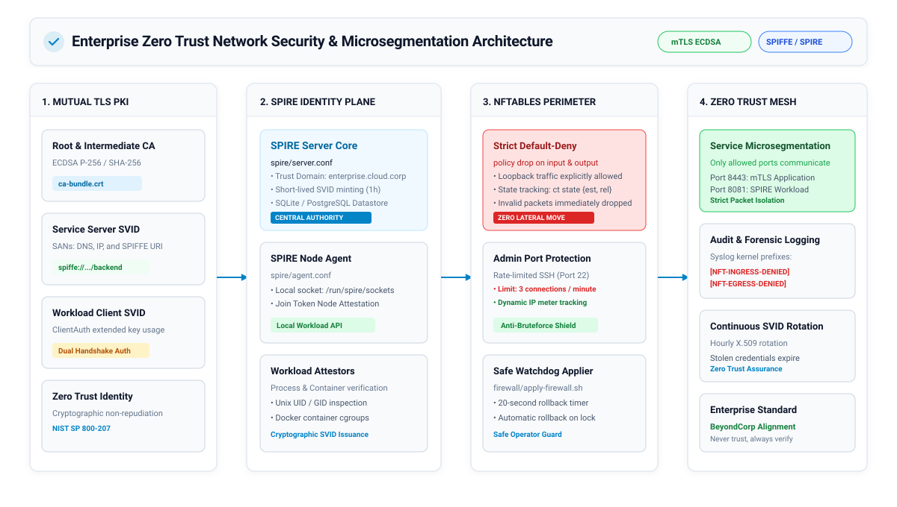

# Zero Trust Network Security & Microsegmentation Suite

[](https://github.com/tayyabmasood911/zero-trust-network-security-scripts/actions)
[](SECURITY.md)
[](LICENSE)
[](https://csrc.nist.gov/publications/detail/sp/800-207/final)
[](https://spiffe.io)

An enterprise-grade Zero Trust infrastructure security and microsegmentation suite. Features automated Mutual TLS (mTLS) PKI certificate generation with SPIFFE ID URIs, strict host-level default-deny `nftables` packet filtering with watchdog rollback protection, and SPIRE node agent workload attestation configuration.

---

## Architectural Blueprint

Embodying NIST SP 800-207 Zero Trust principles ("never trust, always verify"), the architecture binds workload identity to short-lived cryptographic X.509 SVIDs while sealing host network boundaries with default-deny kernel microsegmentation:



---

## Suite Components & Directory Structure

```
zero-trust-network-security-scripts/
├── mtls/
│   ├── generate_mtls_certs.sh           # OpenSSL PKI generator (Root CA, Intermediate CA, SVIDs)
│   └── mtls_cert_manager.py             # Python certificate inspector & SPIFFE URI validator
├── firewall/
│   ├── nftables-zero-trust-default-deny.nft  # Strict default-deny ingress/egress ruleset
│   └── apply-firewall.sh                # Safe deployment wrapper with 20s watchdog auto-revert
├── spire/
│   ├── agent.conf                       # Production SPIRE Node Agent configuration
│   ├── server.conf                      # SPIRE Server configuration (SQLite/PostgreSQL)
│   └── register-workload.sh             # SPIFFE SVID workload registration script
├── scripts/
│   └── healthcheck.sh                   # Environment & configuration self-test
├── tests/
│   └── test_validation.py              # Automated test suite
└── docs/
    └── architecture.svg                 # White-theme visual architecture diagram
```

---

## Core Capabilities

- **Mutual TLS PKI Automation (`mtls/`):** Generates Root and Intermediate Certificate Authorities using ECDSA P-256 curves. Mints server and client certificates embedded with Subject Alternative Names (SANs) and SPIFFE ID URIs (`spiffe://enterprise.cloud.corp/ns/prod/sa/...`).
- **Strict Default-Deny Kernel Firewall (`firewall/`):** Implements an `nftables` policy that drops all ingress and egress packets by default. Permits only loopback, stateful conntrack responses (`ct state established,related`), rate-limited SSH (3 connections/minute), and authorized service ports (8443, 8081, 53).
- **Watchdog Auto-Rollback Engine:** `firewall/apply-firewall.sh` triggers a background watchdog timer during ruleset deployment. If connectivity validation fails, it automatically reverts to the previous firewall state within 20 seconds, eliminating SSH lockout risks.
- **SPIFFE / SPIRE Workload Attestation (`spire/`):** Provisions SPIRE Node Agent and Server configurations that continuously issue and rotate short-lived X.509 SVID credentials for Unix processes, Docker containers, and Kubernetes pods.

---

## Quick Start & Usage

### 1. Generate Mutual TLS PKI Certificates
```bash
# Generate complete Root CA, Intermediate CA, Server, and Client certs
bash mtls/generate_mtls_certs.sh ./certs enterprise.cloud.corp 365

# Inspect and verify certificate validity
python3 mtls/mtls_cert_manager.py --cert certs/server.crt
```

### 2. Safely Deploy Default-Deny Nftables Firewall
```bash
# Apply strict default-deny ruleset with automatic rollback safety net
sudo bash firewall/apply-firewall.sh firewall/nftables-zero-trust-default-deny.nft
```

### 3. Start SPIRE Node Agent
```bash
# Copy agent config to SPIRE directory
sudo cp spire/agent.conf /etc/spire/agent.conf

# Start SPIRE agent daemon
spire-agent run -config /etc/spire/agent.conf
```

---

## Local Verification & Testing

```bash
# Run unit test suite
python3 -m unittest discover -s tests -p "test_*.py"

# Execute healthcheck probe
bash scripts/healthcheck.sh

# Test mTLS manager mock mode
python3 mtls/mtls_cert_manager.py --mock-test
```

---

## Security Governance & Disclosure

For vulnerability disclosures or policy questions, review our [Responsible Disclosure Policy](SECURITY.md) or email maintainer **Tayyab Masood** at [tayyabmasood911@gmail.com](mailto:tayyabmasood911@gmail.com).

---

## License

Licensed under the MIT License. See [LICENSE](LICENSE) for details.
